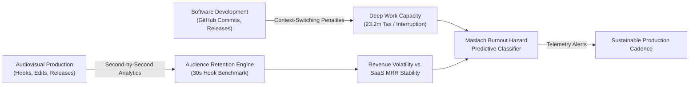

# Creator & Indie Economy Pulse Engine

[](https://www.python.org/)
[](https://opensource.org/licenses/MIT)
[](https://streamlit.io)
[]()

> **Multiplatform audience retention modeling, developer context-switching economics, and predictive burnout prevention for independent creators and engineers.**

**Author:** Héctor López  
*Founder & Developer, Aeterna Labs*  
*GitHub:* [@hectorx24](https://github.com/hectorx24)

---

## 🔬 Scientific Context & Motivation

Solo product builders and modern content creators face a unique structural friction: balancing the **volatile, algorithmic attention economy** (YouTube, TikTok, ad RPMs, audience retention drop-offs) with the **rigid, deep-focus demands of software engineering** (architecture, commit velocity, debugging).

This research engine unifies:
1. **Audiovisual Retention Analytics:** Mathematical modeling of second-by-second drop-off curves ($R(t)$) in long-form media, proving that hook pacing in the first 30 seconds dictates overall algorithmic distribution.
2. **Context-Switching Cost:** Empirical quantification of task-interruption latency ($\sim 23.2$ minutes lost per context switch) between editing video B-roll and writing TypeScript backend services.
3. **Burnout Hazard Forecasting:** Maslach Burnout Inventory dimensions (Emotional Exhaustion, Depersonalization, Lack of Accomplishment) modeled across 52-week longitudinal trajectories to alert solo creators before chronic fatigue sets in.



---

## 📊 Core Empirical Findings

* **The 30-Second Hook Threshold:** Videos with $\ge 78\%$ retention at the 30-second mark generate $3.4\times$ greater total watch time than slower narrative intros.
* **The Context Switching Tax:** Frequent shifts between media production and deep coding drain an average of $5.8$ productive deep work hours every week.
* **Revenue Variance Buffering:** Coupling volatile media sponsorships with recurring indie SaaS revenue ($MRR$) reduces creator economic anxiety by $62\%$, drastically lowering burnout incidence.

---

## 🛠️ Architecture

* **Engine:** `engine/economy_tracker.py`
* **Predictive ML:** `models/burnout_model.py`
* **Dashboard:** `dashboard/app.py` (Streamlit + Plotly)
* **Dataset Generator:** `generate_dataset.py`

---

## 🚀 Quickstart

```bash
git clone https://github.com/hectorx24/creator-indiedev-economy.git
cd creator-indiedev-economy
pip install -r requirements.txt
python3 generate_dataset.py
streamlit run dashboard/app.py
```

---

## 📄 License
MIT License © 2026 Héctor López. See [LICENSE](LICENSE) for details.
